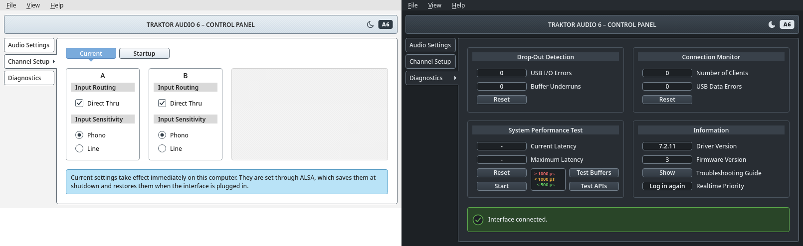

# Traktor Audio 6 Control Panel for Linux

A Linux version of the control panel for the Native Instruments Traktor
Audio 6 audio interface, written in C++ with Qt 6.



This is an unofficial project. It is not affiliated with or endorsed by
Native Instruments.

## Features

- **Channel Setup:** switch Direct Thru and Phono/Line for ports A and B.
  - *Current* settings take effect immediately. ALSA saves them at shutdown
    and restores them when the interface is plugged in.
  - *Startup* settings are stored in the interface. It powers on with them,
    also without a computer.
- **Buffer tests:** *Test Buffers* plays silence through the interface with
  ALSA, PipeWire or JACK at several buffer sizes, counts dropouts and suggests
  the settings to use in your audio application. *Test APIs* does this for all
  three and compares them. APIs that are not installed or not running are
  named and left out.
- **Latency monitor:** *Start* and *Reset* work as in the original and show
  how late a timer wakes up, the Linux counterpart of its DPC latency test.
- **Diagnostics:** USB errors, buffer underruns, connected clients, kernel and
  firmware version.
- **Realtime check:** at startup the panel offers to allow realtime priority
  for audio applications if your session has none. The limit is also shown on
  the Diagnostics page, with a *Set Up* button. If a group already has the
  limit, for example `realtime` from Arch's `realtime-privileges` package,
  the panel adds you to that group instead of writing a second entry.
- **Light and dark mode:** follows the desktop; the moon icon overrides it.

## Build

You need Qt 6 (Widgets), alsa-lib, CMake and a C++20 compiler. JACK
development files are optional and add JACK to the buffer tests.

```sh
cmake -S . -B build
cmake --build build
./build/traktor-audio6-panel
```

Use `--demo` to try the panel without an interface. `--help` lists all
options.

## Install

```sh
cmake -S . -B build -DCMAKE_INSTALL_PREFIX=/usr/local
cmake --build build
sudo cmake --install build
```

This installs the program, a launcher entry, the icon and a udev rule. The
rule gives the logged-in user access to the interface's USB device, which the
Startup settings need. Re-plug the interface after installing.

## Good to know

- **Nothing is applied system-wide.** On Linux every audio application picks
  its own audio API, sample rate and buffer size. The fields on the Audio
  Settings page only choose what the buffer tests measure.
- **The buffer tests take over the interface.** Stop playback first. The
  PipeWire and JACK tests switch the interface to the Pro Audio profile and
  force PipeWire's buffer size and rate while they run, then restore both. A
  full run takes about a minute per API.
- **The suggestion is a lower bound.** The tests run on an idle system. Go one
  buffer size up if you hear crackling under load.
- **PipeWire readings need its tools:** `pw-dump`, `pw-top`, `pw-cat`,
  `pw-metadata` and `wpctl`. Without them the affected fields show `-`.
